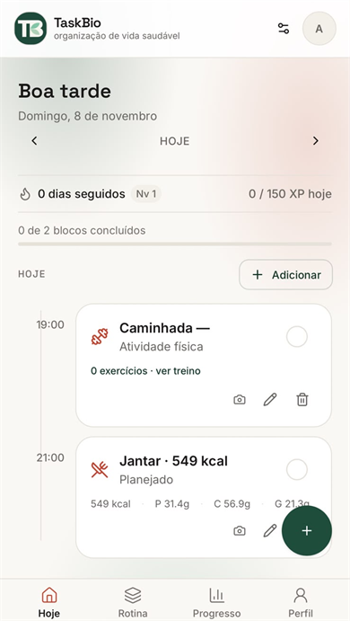
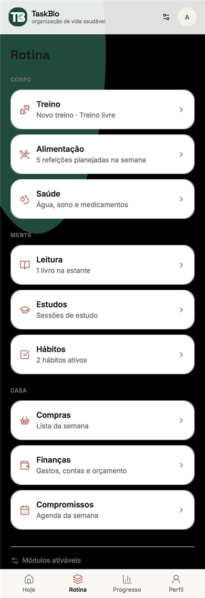
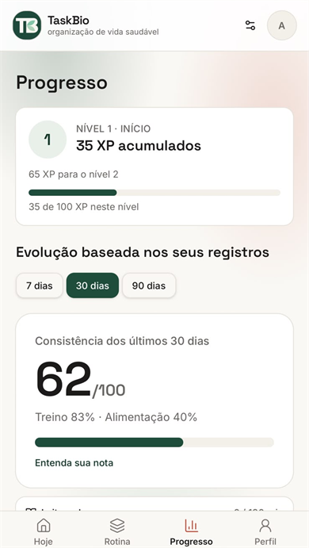

# TaskBio

**Organização de vida saudável num app só.** Agenda, treino, alimentação, hábitos, estudos e
saúde convivem no mesmo dia, com a mesma agenda e a mesma pontuação — em vez de cinco apps e
uma planilha.

[](https://taskbio.com.br)


<table>
  <tr>
    <td align="center" valign="top"><br><sub><b>Hoje</b> — o dia inteiro em uma lista</sub></td>
    <td align="center" valign="top"><br><sub><b>Rotina</b> — 9 módulos em três grupos</sub></td>
    <td align="center" valign="top"><br><sub><b>Progresso</b> — XP, nível e consistência</sub></td>
  </tr>
</table>

<sub>Capturas do app real em produção. A imagem de compartilhamento (`public/og.jpg`) é uma
arte de marca separada.</sub>

---

## O problema

Quem estuda para concurso organiza a vida em cinco lugares: um app de treino, um de alimentação,
um caderno de hábitos, uma planilha de finanças e um cronograma de estudos em PDF. O resultado é
que nenhum deles sabe que **estudar três blocos e treinar 25 minutos disputam o mesmo tempo e a
mesma energia**.

O TaskBio parte de uma regra simples: *um dia, uma lista*. Toda tela responde "o que eu faço
agora?", não "qual módulo eu abro?".

## O que ele faz

- **Agenda/hoje** — o eixo do app: blocos datados de treino, refeição, estudo, leitura e
  compromisso, com confirmação e desfazer atômicos.
- **Treino** — planos com séries, repetições e descanso; importação de plano por arquivo ou foto,
  sempre com revisão humana antes de salvar.
- **Alimentação e compras** — refeições planejadas com totais nutricionais e lista de compras
  gerada a partir do que está pendente.
- **Estudos** — cronograma que gera revisões espaçadas (1/7/30 dias) e as encaixa na rotina do dia.
- **Hábitos, metas, saúde, leitura e finanças** — módulos opcionais, ligados por um registro
  central (`src/lib/modules.ts`) para não exigir refatoração ao adicionar um novo.
- **PWA instalável** — notificações push agendadas, respeitando o horário de silêncio do usuário.

## Stack

| Camada | Escolha |
|---|---|
| UI | React 19, TypeScript, Tailwind CSS v4, shadcn/Radix |
| Roteamento / SSR | TanStack Router + TanStack Start (rotas por arquivo, server functions) |
| Dados | Supabase (Postgres, Auth, Row Level Security), Drizzle ORM |
| Build / deploy | Vite 8, Cloudflare Workers |
| Testes | Vitest (39 suítes em `src/lib`) |
| Integrações | AI SDK (OpenAI) no servidor, Web Push (VAPID), Resend |

## Decisões técnicas (e por quê)

**1. A pontuação é decidida no servidor, não no cliente.**
XP e sequência só podem ser gravados por funções SQL (`grant_xp` / `revoke_xp`), idempotentes por
referência e com teto diário. Um trigger rejeita qualquer escrita direta em `xp_events`.
*Por quê:* é um placar pessoal — se o navegador pudesse escrever nele, não valeria nada.

**2. Row Level Security em tudo.**
Cada usuário lê apenas os próprios registros, e as políticas vivem no banco, não na aplicação.
*Por quê:* a chave pública do Supabase vai para o bundle do cliente por design. A segurança tem
que estar no banco, não em esconder a chave.

**3. Tema por tokens, sem cor literal em componente.**
Todas as cores são variáveis CSS em `src/styles.css`, escopadas por `:root` e `.dark`. Nenhum
componente conhece um valor hexadecimal.
*Por quê:* trocar o tema é trocar valores de token, não caçar 200 arquivos. E um script inline
aplica o tema salvo **antes do primeiro paint**, então não existe "flash" branco ao abrir.

**4. Regras de domínio isoladas e testáveis.**
Cálculos de refeição, hábito, finanças, nível e congelamento de sequência ficam em `src/lib`, em
funções puras cobertas por Vitest — **311 testes em 39 suítes**.
*Por quê:* regra de negócio que mora dentro de componente React não dá para testar nem reutilizar
entre servidor e cliente.

**5. IA só onde ela paga, e com a chave longe do navegador.**
A importação de plano por foto usa OCR no cliente e revisão por IA no servidor; a chave da OpenAI
nunca entra no bundle. Todo resultado passa por confirmação humana antes de virar dado.
*Por quê:* um plano de treino inventado pela IA vira lesão. E chave no cliente vira fatura.

**6. Serviço de push separado do app.**
Lembretes saem por um service worker sem cache e um cron autenticado só no banco, com orçamento
diário por assinatura e retentativa no mesmo dia.
*Por quê:* app fechado ainda precisa receber lembrete, e falha de entrega não pode virar sucesso
falso nem duplicar notificação.

## Estrutura

```
src/
├── components/     # UI reutilizável (design system interno, Radix)
├── routes/         # rotas por arquivo (TanStack) + server functions e APIs
├── lib/            # regras de domínio puras + clientes (Supabase, IA, push)
├── hooks/          # providers e estado de sessão/tema
├── integrations/   # Supabase (client, server, admin)
└── styles.css      # tokens de cor, tema claro e escuro
supabase/           # migrations e funções SQL
tests/              # scripts de verificação de fluxo
```

## Rodando localmente

Requisitos: Node 20+ e Bun.

```bash
bun install
cp .env.example .env      # preencha com as chaves do SEU projeto Supabase
bun run dev
```

Segredos de servidor (`SUPABASE_SERVICE_ROLE_KEY`, `OPENAI_API_KEY`, `RESEND_API_KEY`,
`VAPID_PRIVATE_KEY`) **nunca** vão no `.env` versionado: use o painel do Cloudflare em produção e
`.dev.vars` localmente.

```bash
bun run build     # build de produção
bun run lint      # ESLint
bun run test      # Vitest
```

## Status e escopo

Projeto pessoal em desenvolvimento ativo, com uso real próprio. Não é um produto comercial, não
tem métricas de usuários publicadas e **não** faz promessa de resultado de saúde, diagnóstico ou
prescrição. Valores ausentes ficam ausentes e marcados para revisão — o app não completa
prescrição por conta própria.

---

## English

**TaskBio is a personal routine and health platform for Brazilian exam candidates**, built to stop
people from juggling five apps and a spreadsheet. The agenda is the shared axis: workouts, meals,
study blocks, reading and appointments live in the same day, with the same score.

Built with React 19, TypeScript, TanStack Start and Supabase. The parts worth reading are the
server-side scoring (SQL functions with idempotency and daily caps, enforced by a trigger),
Row Level Security on every table, token-based theming with no literal colors in components, and
311 Vitest tests across 39 suites covering the domain rules. Live at
[taskbio.com.br](https://taskbio.com.br).
